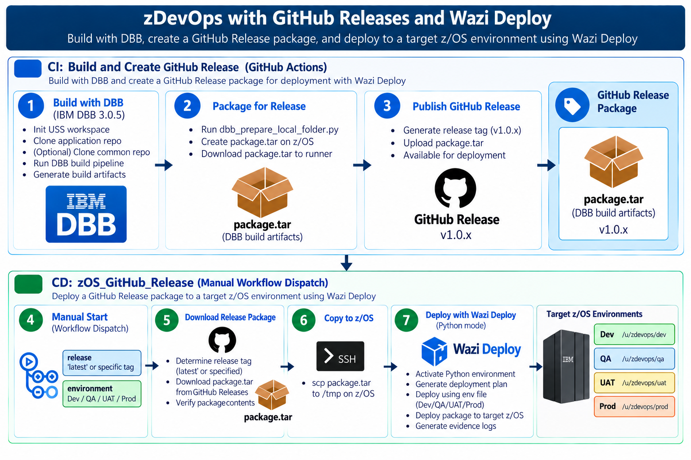
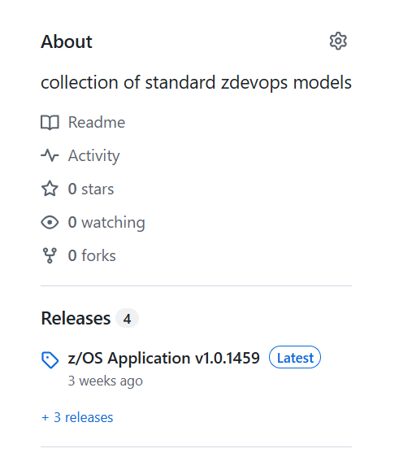
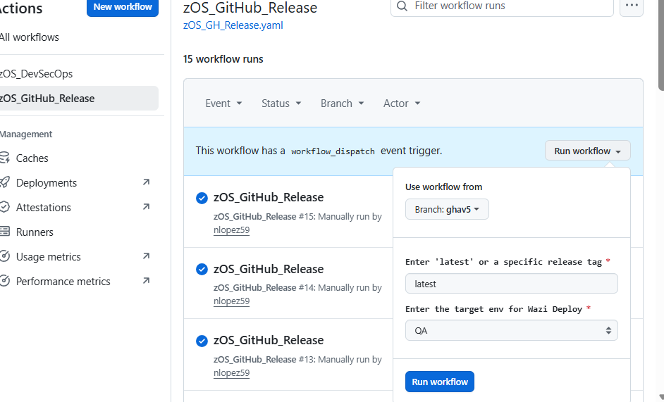
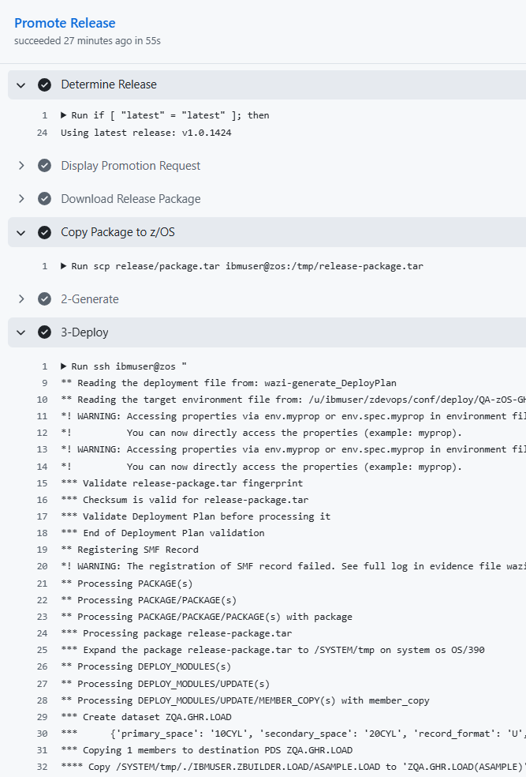

# z/OS GitHub Release Process: Package, Publish, and Deploy

*IBM zLabConnect / zDevOps · Nelson Lopez · September 2026*

This guide describes an end-to-end release process for z/OS applications. IBM Dependency Based Build (DBB) builds the application on z/OS UNIX System Services (USS), the pipeline packages the build outputs and publishes them as a GitHub Release, and IBM Wazi Deploy promotes the selected release to a target environment.

The reference implementation uses two GitHub Actions workflows and one composite action.

| File | Purpose |
|---|---|
| `.github/actions/zBuild/action.yaml` | Composite action that builds, packages, and publishes the release artifact. |
| `.github/workflows/zOS_Build.yaml` | CI workflow that invokes `zBuild` and runs downstream quality gates. |
| `.github/workflows/zOS_GH_Release.yaml` | Manually triggered release workflow that downloads a published artifact and deploys it to a target z/OS environment. |

## Overview



The process has two phases:

1. **CI — Build and publish:** A Git push or manual workflow dispatch starts the build. DBB builds the application on USS, the build outputs are packaged into `package.tar`, and the workflow publishes the package as a versioned GitHub Release. Quality checks, such as static analysis and code coverage, can run as downstream jobs.
2. **CD — Promote and deploy:** An administrator selects a release tag and target environment. The workflow downloads the release artifact, transfers it to USS, generates a Wazi Deploy plan, and executes the plan against the selected environment.

GitHub Releases provide a versioned hand-off between CI and CD. The same published package can be promoted to different environments without rebuilding it.

## Phase 1 — CI: Build, package, and publish

The `zOS_Build.yaml` workflow invokes the `zBuild` composite action. The examples below show the key release-related steps; they are excerpts rather than a complete workflow.

### 1. Package the DBB build outputs on USS

After the DBB build completes, use the build report to prepare the Wazi Deploy package structure, then create a tar archive.

```yaml
- name: Package DBB Artifacts
  shell: powershell
  run: |
    ssh ${{ inputs.zOS }} '${{ inputs.zProfile }}; cd ${{ env.workSpace }}/${{ env.appDirName }}; mkdir -p packDir; python ${{ inputs.zDO }}/scripts/dbb_prepare_local_folder.py -br logs/BuildReport.json -wf packDir; tar -cvf package.tar -C packDir .'
```

The `dbb_prepare_local_folder.py` utility reads `logs/BuildReport.json` and prepares the deployable outputs in `packDir`. The resulting `package.tar` contains the artifacts and metadata expected by the deployment process.

### 2. Copy the package to the GitHub runner

The runner creates a local output directory and copies the package from USS with SCP.

```yaml
- name: Download package.tar from z/OS to Runner Working Directory
  shell: powershell
  run: |
    New-Item -ItemType Directory -Force -Path "build-output"
    scp ${{ inputs.zOS }}:${{ env.workSpace }}/${{ env.appDirName }}/package.tar ./build-output/package.tar
```

The SSH/SCP connection and credentials must already be configured on the self-hosted runner.

### 3. Generate a release tag

This example uses the GitHub Actions run number to generate a tag in the form `v1.0.<run_number>`.

```yaml
- name: Generate Release Tag
  id: create_tag
  shell: powershell
  run: |
    $TAG = "v1.0.${{ github.run_number }}"
    "tag=$TAG" >> $env:GITHUB_OUTPUT
    Write-Host "Release tag: $TAG"
```

### 4. Publish the GitHub Release

The `softprops/action-gh-release` action publishes the release and attaches `package.tar` as its downloadable asset.

```yaml
- name: Publish GitHub Release
  uses: softprops/action-gh-release@v2
  with:
    tag_name: ${{ steps.create_tag.outputs.tag }}
    name: "z/OS Application ${{ steps.create_tag.outputs.tag }}"
    body: |
      Automated z/OS DBB build artifact.

      Application: zos-application
      Version: ${{ steps.create_tag.outputs.tag }}
      Commit: ${{ github.sha }}
      Build: ${{ github.run_number }}
    files: |
      build-output/package.tar
    draft: false
    prerelease: false
  env:
    GITHUB_TOKEN: ${{ inputs.token }}
```

The release description records the application, release version, commit SHA, and workflow run number for traceability.



## Phase 2 — CD: Promote and deploy a release

The `zOS_GH_Release.yaml` workflow is manually triggered with `workflow_dispatch`. The operator chooses a release and target environment. The workflow then downloads the package and uses Wazi Deploy to generate and execute the deployment plan.

### 1. Define the workflow inputs

The `release` input accepts `latest` or a specific release tag. The `environment` input selects the deployment target.

```yaml
name: zOS_GitHub_Release

on:
  workflow_dispatch:
    inputs:
      release:
        description: "Enter 'latest' or a specific release tag"
        default: latest
        required: true
      environment:
        description: "Target environment for Wazi Deploy"
        default: QA
        type: choice
        options:
          - Dev
          - QA
          - UAT
          - Prod
        required: true
```



### 2. Configure the deployment job and environment gate

Use a self-hosted runner that can access the target z/OS system. GitHub Environments can provide required reviewers and environment-scoped secrets or variables. Configure protection rules for sensitive environments such as UAT and Production.

```yaml
jobs:
  deploy:
    name: Promote Release
    runs-on: self-hosted
    timeout-minutes: 15
    environment:
      name: ${{ inputs.environment }}
    permissions:
      contents: read
```

### 3. Resolve the release tag

If the operator enters `latest`, use the GitHub CLI to retrieve the most recent published release tag. Otherwise, use the supplied tag.

```yaml
- name: Determine Release
  id: release
  shell: bash
  env:
    GH_TOKEN: ${{ github.token }}
  run: |
    if [ "${{ inputs.release }}" = "latest" ]; then
      RELEASE=$(gh release view \
        --repo "${{ github.repository }}" \
        --json tagName \
        --jq '.tagName')
      echo "Using latest release: $RELEASE"
    else
      RELEASE="${{ inputs.release }}"
      echo "Using specified release: $RELEASE"
    fi

    echo "release=$RELEASE" >> "$GITHUB_OUTPUT"
```

### 4. Display the promotion request

Print the selected release and environment in the job log before downloading or deploying the package.

```yaml
- name: Display Promotion Request
  shell: bash
  run: |
    echo "======================================"
    echo "Release Promotion"
    echo "======================================"
    echo "Release     : ${{ steps.release.outputs.release }}"
    echo "Environment : ${{ inputs.environment }}"
    echo "======================================"
```

### 5. Download and inspect the package

The GitHub CLI downloads `package.tar` from the selected release. The example then lists the archive contents for visibility in the job log.

```yaml
- name: Download Release Package
  shell: bash
  env:
    GH_TOKEN: ${{ github.token }}
  run: |
    mkdir -p release
    gh release download \
      "${{ steps.release.outputs.release }}" \
      --repo "${{ github.repository }}" \
      --pattern "package.tar" \
      --dir release \
      --clobber

    echo "Downloaded package:"
    ls -lh release/package.tar
    echo "Package contents:"
    tar -tvf release/package.tar
```

### 6. Copy the package to z/OS USS

Transfer the package to the target z/OS system. The following steps assume it is placed in `/tmp/release-package.tar`.

```yaml
- name: Copy Package to z/OS
  shell: bash
  run: |
    scp release/package.tar ${{ vars.zOS }}:/tmp/release-package.tar
```

### 7. Generate the Wazi Deploy plan

Connect to USS, initialize the required shell environment, activate the Wazi Deploy Python environment, and generate the deployment plan and report.

```yaml
- name: Generate Deployment Plan
  shell: bash
  run: |
    ssh ${{ vars.zOS }} "
      ${{ vars.zProfile }}
      cd /tmp
      . /global/opt/pyenv/gdp/bin/activate
      wazideploy-generate \
        --deploymentMethod ${{ vars.zDO }}${{ vars.wdg_in_Method }} \
        --packageInputFile release-package.tar \
        --deploymentPlan ${{ vars.wdg_out_Plan }} \
        --deploymentPlanReport ${{ vars.wdg_out_PlanReport }} \
        --workingFolder .
      deactivate"
```

The deployment plan describes the resources to be deployed and the actions Wazi Deploy will perform.

### 8. Execute the deployment

Run `wazideploy-deploy` with the selected environment's configuration file. The command writes an evidence file that can be retained as a deployment record.

```yaml
- name: Deploy Release
  shell: bash
  run: |
    ssh ${{ vars.zOS }} "
      ${{ vars.zProfile }}
      cd /tmp
      . /global/opt/pyenv/gdp/bin/activate
      wazideploy-deploy \
        --envFile ${{ vars.zDO }}/deploy/${{ inputs.environment }}-zOS-GHR.env \
        --packageInputFile release-package.tar \
        --deploymentPlan ${{ vars.wdg_out_Plan }} \
        --evidencesFileName ${{ vars.wdd_out_Evidence }} \
        --workingFolder .
      deactivate"
```



## Configuration reference

The following repository or organization variables are used by the examples. Configure them under **Settings → Secrets and variables → Actions → Variables**, and store credentials or tokens as secrets rather than plain variables where appropriate.

| Variable | Purpose |
|---|---|
| `vars.zOS` | SSH user and hostname for the target z/OS system. |
| `vars.zProfile` | Shell commands used to initialize the z/OS environment before running DBB or Wazi Deploy. |
| `vars.zDO` | USS path to the central zDevOps configuration directory. |
| `vars.wdg_in_Method` | Relative path to the Wazi Deploy method YAML under the zDevOps configuration directory. |
| `vars.wdg_out_Plan` | Output path or filename for the generated deployment plan. |
| `vars.wdg_out_PlanReport` | Output path or filename for the deployment plan report. |
| `vars.wdd_out_Evidence` | Output path or filename for the Wazi Deploy evidence file. |

The examples also use workflow inputs such as `inputs.zOS`, `inputs.zProfile`, `inputs.zDO`, and `inputs.token` in the composite action. Define these inputs in the composite action's `action.yaml`.

## Design considerations

- **Build once, promote the same artifact:** The GitHub Release separates build execution from deployment. The package can be reused across environments without rebuilding.
- **Use one deployable package:** `package.tar` is the hand-off artifact consumed by Wazi Deploy.
- **Require explicit promotion:** Manual selection of a release and target environment helps prevent accidental deployments.
- **Protect sensitive environments:** Configure GitHub Environment reviewers and protection rules for UAT and Production.
- **Keep environment settings separate:** Environment-specific `.env` files hold target parameters such as library names and subsystem settings.
- **Use a suitable self-hosted runner:** The runner must have the GitHub CLI and SSH/SCP access to the z/OS system. The workflow examples also use Bash for multi-line remote commands and PowerShell in the build composite action.

## Appendix — `dbb_prepare_local_folder.py`

This sample utility reads the DBB build report and copies deployable outputs into a directory structure suitable for packaging. It assigns Wazi Deploy deployment types to output filenames and selects a copy mode for each type.

Reference: [IBM documentation — Static Python translator for deployment](https://www.ibm.com/docs/en/developer-for-zos/16.0?topic=deployment-static-python-translator#wd_gettingstarted_static_python__title__3).

> The script below is included from the supplied source. Review it against your installed DBB/Wazi Deploy versions and local requirements before using it in production.

```python
# IBM sample Python script to add DBB Deploy Types to artifact filename extensions.

import argparse
import sys
import os
import platform
import re
import json
import subprocess
from pathlib import Path


class DBBUtilities(object):
    @staticmethod
    def filter_deployable_records(record) -> bool:
        try:
            if (record['type'] == 'EXECUTE' or record['type'] == 'COPY_TO_PDS') and len(record['outputs']) > 0:
                for output in record['outputs']:
                    try:
                        if output['deployType']:
                            record['deployType'] = output['deployType']
                            record['dataset'] = output['dataset']
                            return True
                    except:
                        pass
        except:
            pass
        return False

    @staticmethod
    def filter_deleted_records(record) -> bool:
        try:
            if record.get('deletedBuildOutputs'):
                return True
        except:
            pass
        return False

    @staticmethod
    def read_build_result(read_build_result_file) -> dict:
        with open(read_build_result_file) as read_file:
            return dict(json.load(read_file))

    @staticmethod
    def get_copy_mode(deployType: str = "LOAD", **kwargs) -> str:
        if kwargs.get('copyModeProperties') is not None:
            props = {}
            props_yaml_file = kwargs['copyModeProperties']
            try:
                with open(props_yaml_file, 'r') as stream:
                    props = dict(yaml.safe_load(stream))
                    if props.get(deployType) is not None:
                        return props.get(deployType)
            except IOError as error:
                print(error, file=sys.stderr)
                raise RuntimeError(
                    f"!!! Couldn't open target environment file from: {props_yaml_file} !!!"
                )

        if re.search('LOAD', deployType, re.IGNORECASE):
            return "LOAD"
        elif re.search('DBRM', deployType, re.IGNORECASE):
            return "BINARY"
        elif re.search('PSB', deployType, re.IGNORECASE):
            return "LOAD"
        elif re.search('DBD', deployType, re.IGNORECASE):
            return "LOAD"
        elif re.search('TEXT', deployType, re.IGNORECASE):
            return "TEXT"
        elif re.search('COPY', deployType, re.IGNORECASE):
            return "TEXT"
        elif re.search('OBJ', deployType, re.IGNORECASE):
            return "BINARY"
        elif re.search('DDL', deployType, re.IGNORECASE):
            return "TEXT"
        elif re.search('JCL', deployType, re.IGNORECASE):
            return "TEXT"
        else:
            return "TEXT"


def run_command(command: str, verbose: bool = True):
    process = subprocess.run(command.split(), capture_output=True, text=True)

    if process.returncode != 0 and verbose:
        print("stdout:", process.stdout, file=sys.stdout)
        print("stderr:", process.stderr, file=sys.stderr)

    return process.returncode, process.stdout, process.stderr


def copy_dbb_build_result_to_local_folder(**kwargs):
    dbb_build_result_file = kwargs['dbbBuildResult']
    working_folder = kwargs['workingFolder']

    buildResult = DBBUtilities.read_build_result(dbb_build_result_file)
    records = list(
        filter(
            lambda record: DBBUtilities().filter_deployable_records(record),
            buildResult['records'],
        )
    )

    for record in records:
        dataset = record['dataset']
        deploy_type = record['deployType']
        parts = re.split(r'\(|\)', dataset)
        if len(parts) < 2:
            print(f"** WARNING: {parts[0]} has no members!!!")
            continue

        member_name = parts[1]
        pds_name = parts[0]
        os.makedirs(f"{working_folder}/{pds_name}", exist_ok=True)
        copyMode = DBBUtilities.get_copy_mode(deploy_type, **kwargs)
        msgstr = (
            f"** Copy //'{dataset}' to "
            f"{working_folder}/{pds_name}/{member_name}.{deploy_type} ({copyMode})"
        )
        print(msgstr)

        if copyMode == 'LOAD':
            cmd = f"cp -XI //'{dataset}' {working_folder}/{pds_name}/{member_name}.{deploy_type}"
        elif copyMode == 'BINARY':
            cmd = f"cp -F bin //'{dataset}' {working_folder}/{pds_name}/{member_name}.{deploy_type}"
        else:
            cmd = f"cp //'{dataset}' {working_folder}/{pds_name}/{member_name}.{deploy_type}"

        if platform.system() == 'OS/390':
            rc, out, err = run_command(cmd)
            if rc != 0:
                msgstr = f"*! Error executing command: {cmd} out: {out} error: {err}"
                print(msgstr)
                sys.exit(-1)

            if copyMode == 'TEXT':
                cmd = f"chtag -r {working_folder}/{pds_name}/{member_name}.{deploy_type}"
            else:
                cmd = f"chtag -b {working_folder}/{pds_name}/{member_name}.{deploy_type}"

            rc, out, err = run_command(cmd)
            if rc != 0:
                msgstr = f"*! Error executing command: {cmd} out: {out} error: {err}"
                print(msgstr)
                sys.exit(-1)


def main():
    parser = argparse.ArgumentParser(description="DBB Prepare Package")
    parser.add_argument(
        '-br', '--dbbBuildResult', required=True,
        help='The DBB build result file'
    )
    parser.add_argument(
        '-wf', '--workingFolder', required=True,
        help='The path to the working folder'
    )
    parser.add_argument(
        '-cp', '--copyModeProperties',
        help='The path to the file that contains copy mode properties'
    )

    if len(sys.argv[1:]) == 0:
        parser.print_help()
        return

    args = parser.parse_args()
    kwargs = vars(args)
    copy_dbb_build_result_to_local_folder(**kwargs)


if __name__ == '__main__':
    main()
```
